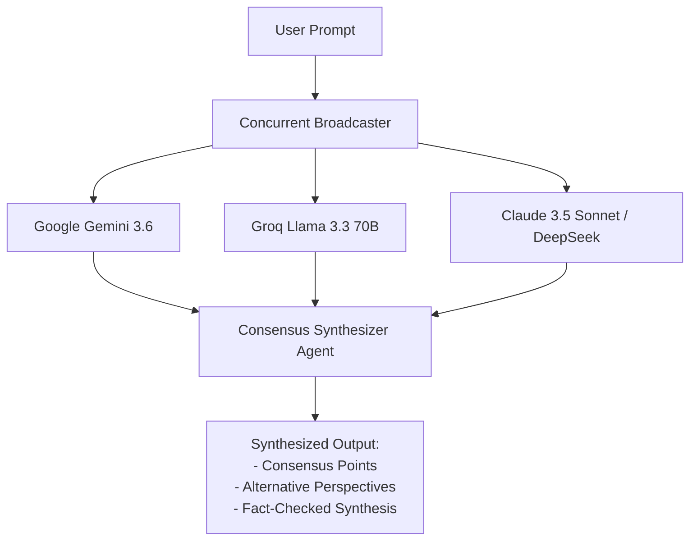

# OmniAI — Future Scope & Architectural Roadmap

This document outlines the strategic enhancements, research directions, and scaling roadmap planned for future iterations of **OmniAI**.

---

## 1. Advanced Vector RAG (Retrieval-Augmented Generation)

### Current Implementation
OmniAI currently uses semantic character chunking with direct prompt grounding for documents up to 10MB.
### Future Enhancement
* **Embedded Vector Storage**: Integration of embedded vector databases such as **ChromaDB** or **sqlite-vss** to support large-scale document repositories (thousands of pages).
* **Hybrid Lexical & Dense Search**: Combining BM25 keyword matching with dense embeddings (`text-embedding-3-small` or local BGE embeddings) using Reciprocal Rank Fusion (RRF).
* **Cross-Encoder Re-Ranking**: Implementing FlashRank or Cohere Re-ranker to elevate the most relevant passages before context window assembling.

---

## 2. Multi-Agent AI Council Consensus Engine

### Vision
Rather than presenting user queries to a single model, OmniAI will offer an optional **Council Mode**:

* **Discrepancy Highlighting**: Identifies subtle factual disagreements or code bugs flagged by one model but missed by another.

---

## 3. On-Device Local Model Inference (Ollama / Llama.cpp)

### Vision
* **100% Offline Capability**: Native integration with local model runners (Ollama, vLLM, or llama.cpp) running on consumer hardware (Apple Silicon M-series or NVIDIA RTX GPUs).
* **Privacy-First Workspace**: Eliminates external API calls entirely for sensitive medical, legal, or proprietary codebases.

---

## 4. Multi-Tenant Enterprise Architecture

### Vision
* **Authentication**: Migration from single-tenant access tokens to OAuth2 with OpenID Connect (Google, GitHub, Keycloak) and JWT session handling.
* **Database Partitioning**: Migration path from SQLite to PostgreSQL with row-level security (RLS) isolating conversations per tenant.
* **Team Collaboration**: Shared workspace folders, team prompt libraries, and collaborative document annotation.

---

## 5. Real-Time Multimodal Voice & Vision

* **Audio Streaming**: Bidirectional voice conversation utilizing WebSockets / WebRTC integrated with Gemini Multimodal Live API.
* **Vision & Image Understanding**: Direct drag-and-drop of architectural blueprints, diagrams, and screenshots for multimodal reasoning.
