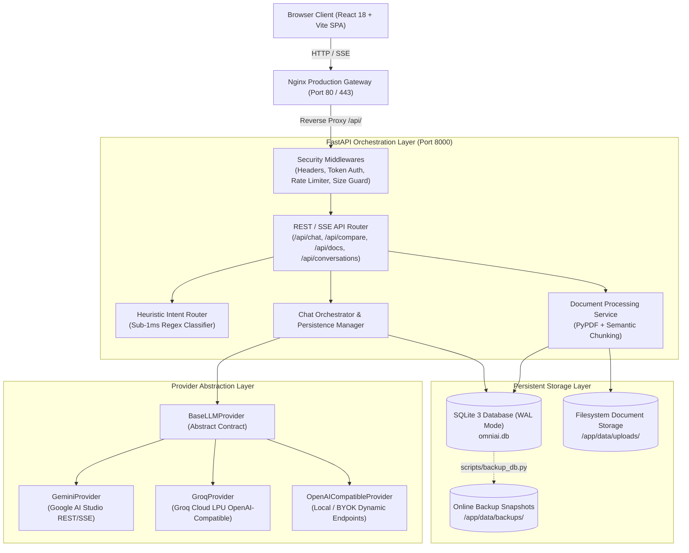
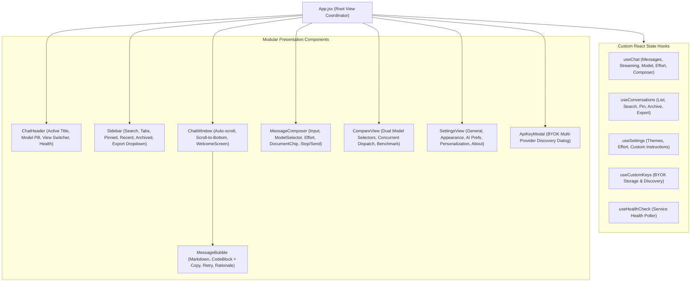
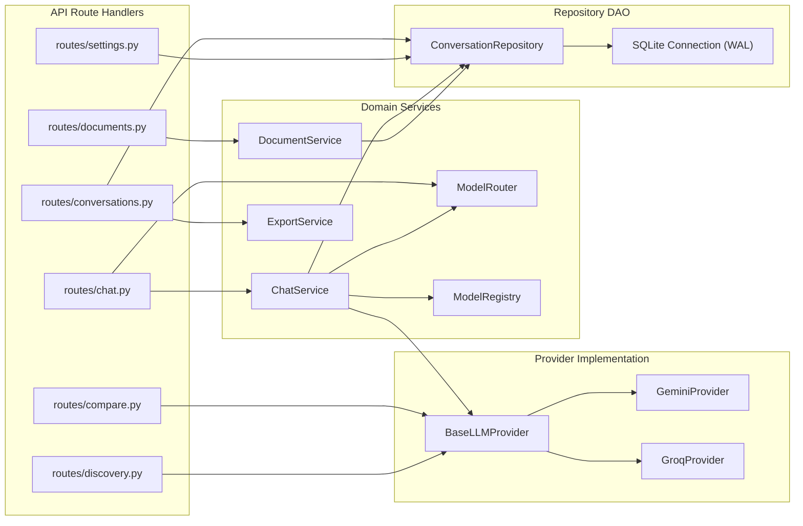
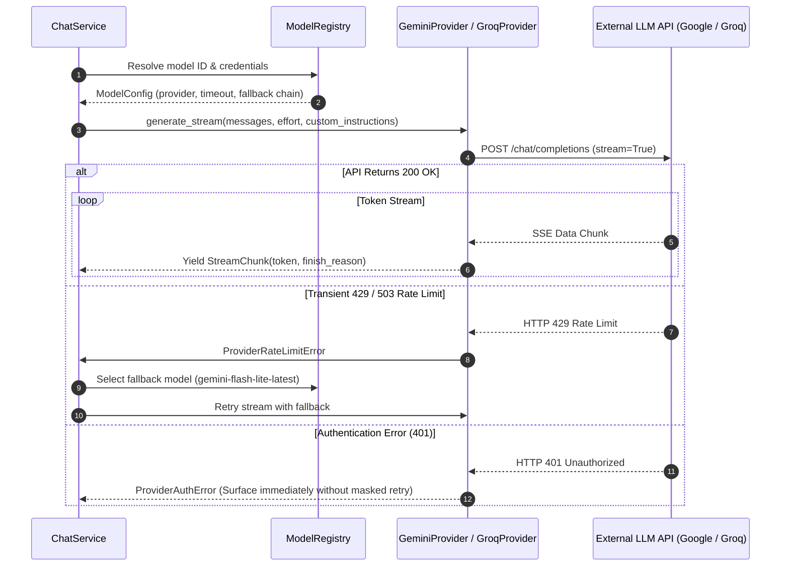
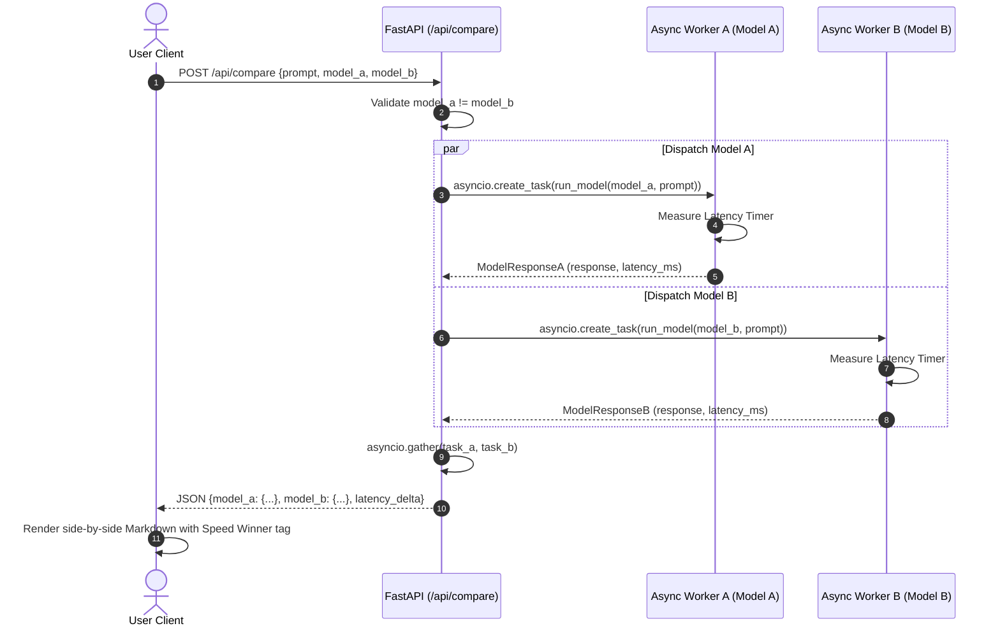
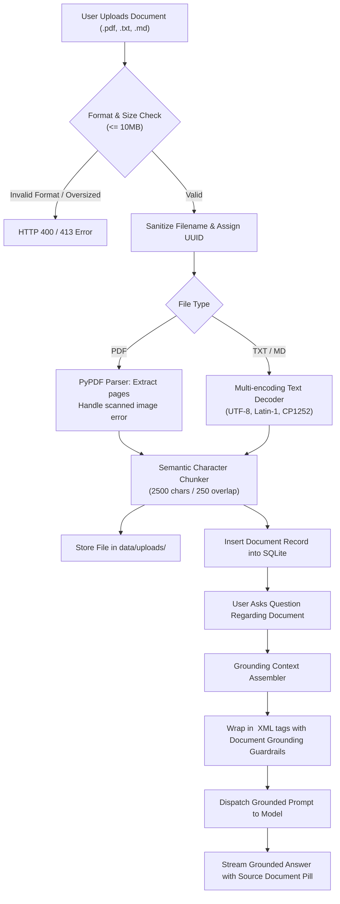
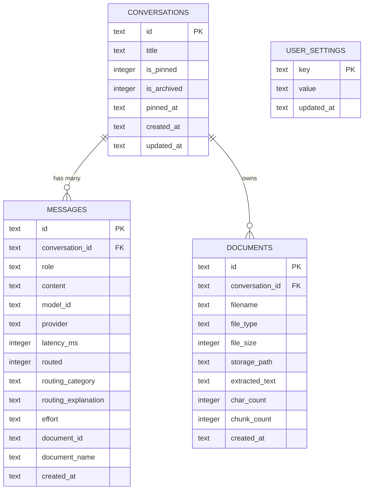
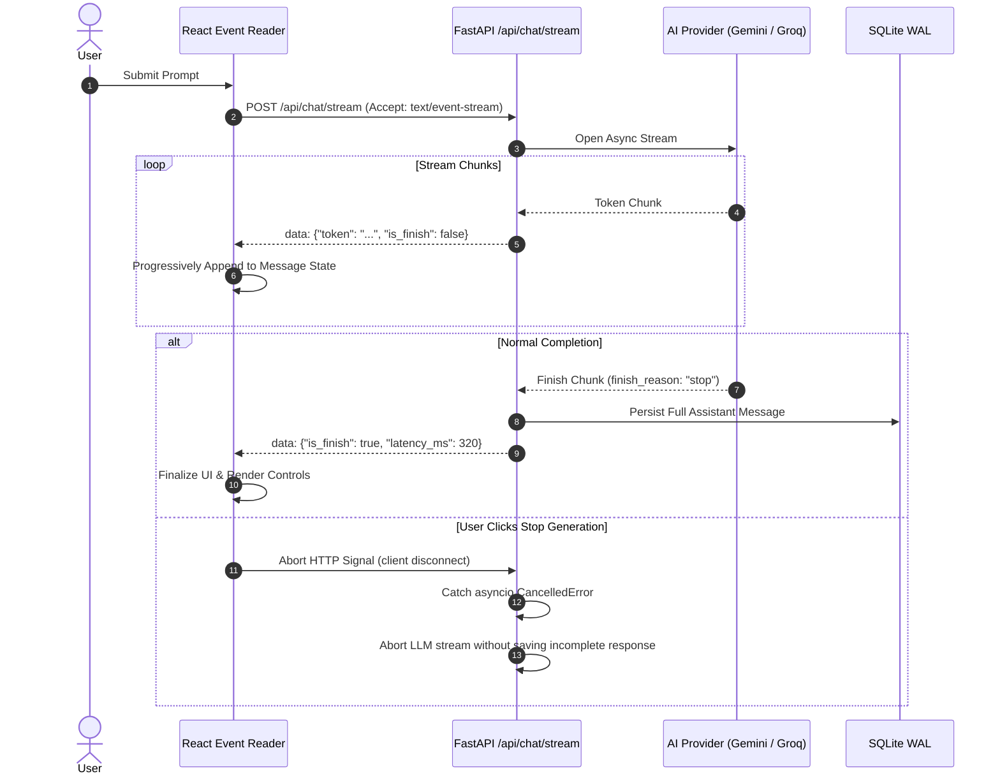

# OmniAI — System Architecture & Design Specification

This document provides complete architectural blueprints, data flow diagrams, and component models for **OmniAI — Intelligent Multi-Model AI Chatbot**.

---

## 1. High-Level System Architecture

OmniAI follows a modern, decoupled layered architecture separating Presentation, Orchestration, Provider Abstraction, and Persistent Storage.



---

## 2. Frontend Component Architecture

The React 18 user interface is organized into a single-direction reactive state hierarchy managed by custom React hooks.



---

## 3. Backend Service Architecture

The FastAPI backend implements clean domain-driven service boundaries.



---

## 4. AI Provider Integration Workflow

Providers adhere to a unified asynchronous contract supporting non-streaming completion, streaming token generators, and error normalization.



---

## 5. Intelligent Routing Workflow (Auto Mode)

Deterministic regex heuristics classify user intent in `<1ms` without consuming secondary LLM tokens.

```mermaid
flowchart TD
    Prompt["Incoming User Prompt"] --> Normalize["Lower-case & Tokenize Text"]
    Normalize --> RegexChecks{"Pattern Matchers"}

    RegexChecks -->|Coding keywords: def, class, bug, sql, async, python| Coding["Category: coding\nTarget: Groq LPU (Llama 3.1 8B Instant)"]
    RegexChecks -->|Reasoning keywords: prove, calculate, evaluate, bat and ball| Reasoning["Category: reasoning\nTarget: Google Gemini (Gemini 3.6 Flash)"]
    RegexChecks -->|Writing keywords: draft, email, essay, poem, summarize| Writing["Category: writing\nTarget: Google Gemini (Gemini 3.6 Flash)"]
    RegexChecks -->|No specific category pattern matched| General["Category: general\nTarget: Default High-Speed Gemini Model"]

    Coding --> CheckAvail{"Is Preferred Model Available?"}
    Reasoning --> CheckAvail
    Writing --> CheckAvail
    General --> CheckAvail

    CheckAvail -->|Yes| Dispatch["Dispatch to Optimal Provider"]
    CheckAvail -->|No (Missing Key / Quota)| Fallback["Active Fallback to Next Configured Engine"]

    Dispatch --> Output["Response with 'Auto: {category}' badge and explanation"]
    Fallback --> Output
```

---

## 6. Model Comparison Workflow

Broadcasts an identical prompt concurrently to two distinct model engines via Python's asynchronous event loop.



---

## 7. Document Upload & Grounded Analysis Workflow

Ingests documents, chunks text, and strictly grounds model answers in factual context.



---

## 8. Database Entity Relationship Diagram (ERD)

OmniAI uses an embedded SQLite 3 schema with foreign key cascades and composite indexes.



---

## 9. Streaming Response Workflow (Server-Sent Events)



